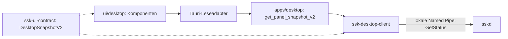

# Desktop- und Backend-Anbindung

Stand: 24. September 2026. Ein startbarer Windows-Host und eine lesende Verbindung
zum Daemon sind implementiert. UI-Entwicklung bleibt im separaten Paket.

## Beobachtung und Aussagekraft

Die neue Dienstkarte zeigt gemeldeten Laufzeitzustand, Version, aktives Profil,
Anzahl gemeldeter Adapter und optionalen Fehlercode. Rohmeldungen, Pfade und
Fehlerhinweise werden nicht an das Frontend weitergereicht.

Die vorhandene IPC-Antwort `StatusDto` enthält keine vollständige Beobachtung der
Schutzgrenze. Ihre booleschen Angaben `dns_protected` und `kill_switch` sowie
`audit_head` werden deshalb nicht als Nachweis in die UI übersetzt. V2 erlaubt
ausschließlich `panel_state: degraded` und die Dienstkarte. Antworten mit
zusätzlichen Schutz-, Audit- oder Verbindungsfeldern werden abgewiesen.
Auch ein vom Daemon gemeldetes `Protected` bleibt eine gekennzeichnete Dienstangabe.

`PanelSnapshotV1` und die vorhandenen Bridge-Projektionen bleiben für die
Entwicklungsszenarien bestehen. Der produktive Desktop-Adapter akzeptiert nur V2;
er kann keine V1-Beispielantwort als echten Schutzstatus anzeigen. V2 verlangt im
Leseadapter begrenzte Texte (256 UTF-8-Bytes, keine Steuerzeichen) und höchstens
256 Adapter. Der Browser prüft dieselben Darstellungsgrenzen zusätzlich. Serde
allein prüft nur Typen/Feldformen, nicht diese Größenbeschränkungen.

## Lesezugriff und Lebensdauer

- Der Host ermittelt den benutzerbezogenen Endpunkt beim Start. Browserargumente
  können weder Endpunkt noch IPC-Befehl auswählen; relative Zustandspfade scheitern.
- Eine frische Verbindung pro Abfrage, höchstens eine laufende Abfrage, zwei
  Sekunden für Verbindung und Antwort zusammen. Konkurrenz wird sofort als
  `busy` abgewiesen; es entsteht keine Warteschlange.
- Fehler werden zu festen Codes: `endpoint_unavailable`, `unavailable`,
  `deadline`, `busy`, `invalid_response`. Abbruch der Rust-Zukunft schließt die
  Verbindung und gibt den Leseplatz frei.
- Der UI-Controller ignoriert überholte Antworten, hat zusätzlich drei Sekunden
  Antwortlimit und entfernt die Beobachtung zehn Sekunden nach Empfang. Tauri
  Invoke selbst wird vom Browser-Abbruch nicht beendet; das native Zeitlimit
  von zwei Sekunden bleibt wirksam. Es gibt noch keine automatische Aktualisierung.

Diese Zeiten begrenzen eine lokale Abfrage und die Anzeigedauer. Sie belegen
weder das Alter der ursprünglichen Messung noch den Schutz des Betriebssystems.

## Fenster und Vertrauensgrenze

Der Host bündelt ausschließlich die Produktionsdateien; Vorschauseite, Fixtures,
Entwicklungsserver und Tests sind nicht im Web-Paket. Er öffnet das Fenster `main`
am gebündelten Ursprung. Andere Navigationsursprünge und neue Fenster werden
abgewiesen. CSP erlaubt lokale Skripte/Stile und den benötigten Tauri-IPC-Kanal.
Es gibt keine Shell-, Dateisystem-, HTTP- oder Prozess-Plugins.

Das App-Manifest registriert nur den Lesebefehl. Die ausgewählte Capability erlaubt
ihn nur lokal für `main`, ohne Standard-Core-Berechtigungen oder Remote-Freigaben.
Der Handler prüft Fenstername und Ursprung zusätzlich. Das ist erforderlich, weil
App-Befehle ohne explizites App-Manifest in Tauri grundsätzlich weiter erreichbar
sein können. Siehe [Tauri-Capabilities](https://v2.tauri.app/security/capabilities/)
und [CSP-Konfiguration](https://v2.tauri.app/security/csp/).

Die Named-Pipe-Authentifizierung des bestehenden Daemons prüft den **Client**.
Der Desktop-Leseadapter hat noch keinen kryptografischen oder prozessgebundenen
Nachweis der **Serveridentität**. Ein Angreifer im selben Benutzerkontext kann
deshalb nicht allein durch den Pipe-Namen ausgeschlossen werden. Die neue Ansicht
bleibt eine Diagnoseanzeige; für spätere bestätigte Schutzangaben braucht es
authentifizierte Quellen, abgeglichene Zustände und einen überprüfbaren Zeitbezug.

## Nächste Ausbauschritte

Serverherkunft und Quellaktualität absichern; danach echte Broker-/Audit- und
Verbindungsbeobachtungen mit eigenem versioniertem Vertrag anschließen.
Schreibaktionen erhalten getrennte, eng begrenzte Befehle und werden im
Dienst/Broker autorisiert. Eine beliebige IPC-Durchreiche im Host ist nicht vorgesehen.

Windows-VM-Abnahme, OpenVPN-Bereitschaft, aktive WFP-Durchsetzung, systemweite
ETW-Freigabe, Installer und signierte Distribution bleiben eigenständige Aufgaben.

[Bau- und Startanleitung](../apps/desktop/README.md),
[modulare UI](MODULAR_DESKTOP_UI.md).
