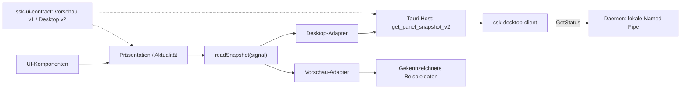

# Modulare Desktop-Oberfläche

Stand: 24. September 2026. Die Oberfläche wird als eigenständiges Paket unter
`ui/desktop` entwickelt. Layout, Komponenten und Zustandsdarstellung können ohne
Neubau oder Start des Netzwerk-/Sicherheitskerns geändert und getestet werden.
Ein gemeinsamer Datenvertrag und austauschbare Adapter bilden die Grenze.

Die Pfeile zum Port beschreiben Datenzugriffe, keine Schutzbefugnisse. Komponenten
kennen weder Tauri noch native Windows-APIs. Nur der jeweilige Einstieg wählt den
Adapter. Eine fehlende oder fehlerhafte Desktop-Verbindung führt niemals
automatisch zu Beispieldaten.

## Gemeinsamer Vertrag

`ssk-ui-contract` enthält die bisherigen Anzeige-DTOs, `PanelState` und den
neuen `PanelSnapshotV1`. Seine einzige direkte Laufzeitabhängigkeit ist Serde.
Die Bridge exportiert die bisherigen Typnamen weiter; Systemtypen werden dort
über reine Abbildungsfunktionen in DTOs übersetzt. Die früheren `From<Systemtyp>`-
Implementierungen entfallen, damit der Vertrag keine Systemabhängigkeiten erhält.
Es gibt keine weiteren gefundenen Verbraucher dieser Konvertierungen.

`PanelSnapshotV1` enthält `schema_version: 1`, `panel_state` und die optionalen
Abschnitte `kill_switch`, `audit`, `connections`. Fehlende Abschnitte ersetzen
alte Daten vollständig. Unbekannte Versionen, Zustände und zusätzliche Felder
werden abgewiesen. Der JavaScript-Validator prüft zusätzlich sichere Ganzzahlen,
32-Bit-Prozessnummern, 64-stellige Hex-Digests, Zeichenketten bis 1.024 Zeichen
und maximal 256 Zeilen je Tabelle. Größere Datenmengen benötigen künftig
einen ausdrücklichen Vertrag für Seitennavigation; sie werden nicht still gekürzt.

Rust-Deserialisierung allein prüft diese zusätzlichen Darstellungsgrenzen nicht.
Ein künftiger Host muss sie vor Ausgabe berücksichtigen. Geteilte JSON-Szenarien
werden von Rust und JavaScript getestet. Das sichert die Beispielschnittmenge;
eine vollständige Schemagenerierung ist noch nicht implementiert.
Inkompatible Änderungen erhalten eine neue Vertrags-/Befehlsversion.

Der startbare Desktop-Host verwendet `DesktopSnapshotV2`: eine begrenzte
Dienstzusammenfassung ohne Schutzbestätigung. Der echte Desktop-Adapter akzeptiert
nur V2. Die Einzelheiten und verbleibenden Vertrauensgrenzen stehen in der
[Beschreibung der Backend-Anbindung](DESKTOP_BACKEND_CONNECTION.md).

## Lebensdauer und Schutzanzeige

Die Quelle bietet `readSnapshot({signal})` an. Der Controller überwacht drei
Sekunden Antwortzeit und verwirft überholte Antworten nach weiteren Anfragen oder
Schließen der Ansicht. Zehn Sekunden nach Empfang entfernt er die Daten aus der
Ansicht. Die Tauri-Invoke-Funktion selbst ist nicht abbrechbar; spätes Eintreffen
ändert die Ansicht trotzdem nicht mehr. Transportfehler, ungültige Daten und
Aktualisierung entfernen zuvor angezeigte Bestätigungen.

Grün für den Kill-Switch erfordert eine aktuelle, vollständig passende Beobachtung:
`engaged`, vorhandene OS-Regel, konsistenter Abgleich, Bestätigungsfeld, passende
Journalangabe und keine Alarmangabe. Eingeschränkte oder widersprüchliche Zustände
überstimmen eine positive Behauptung. Die UI zeigt eine Backend-Meldung an; sie
prüft keine Firewall selbst. Ein vertragskonformer Datensatz ist weder
authentifiziert noch ein Nachweis vollständigen Systemschutzes.

## Entwicklung und Integration

[Startanleitung und Ordnerübersicht](../ui/desktop/README.md).
Für Layoutarbeit genügt der lokale statische Server; es gibt keinen npm-Install,
Rust-Build oder laufenden Dienst als Voraussetzung. Die acht Vorschauzustände
sind dauerhaft als Beispieldaten gekennzeichnet. Die reguläre Seite fällt ohne
Desktop-Host auf „Nicht verbunden“ zurück.

Der [Windows-Host](../apps/desktop/README.md) implementiert ausschließlich den
Leseaufruf `get_panel_snapshot_v2` und liest dafür den vorhandenen Daemon-Status.
Autorisierung und alle Zustandsänderungen bleiben im Dienst/Broker. Für spätere
Bedienaktionen sind getrennte, eng begrenzte Befehle mit Fehler-/Berechtigungsvertrag
erforderlich; HTML/JS erhält keine Shell-, Dateisystem- oder generischen
Ausführungsrechte. Der Host liegt in einem eigenen Cargo-Workspace.

Noch offen sind Quellzeit-/Serverherkunftsprüfung, vollständige Schutz-/Audit- und
Verbindungsbeobachtungen, pushbasierte Aktualisierung und Produktpaketierung.
Auch isolierte Windows-Abnahme, OpenVPN-Bereitschaft und aktive WFP-Durchsetzung
werden durch die UI-Vorschau nicht erledigt.

## Prüfung

- Eigenständige Node-Tests für Vertragsgrenzen, Anzeigepriorität, Ablaufzeiten,
  verspätete Antworten, Abbruch und Modulabhängigkeiten.
- Rust-Vertragstests verwenden dieselben acht JSON-Szenarien wie die Vorschau.
- Ein Cargo-Metadaten-Test verhindert direkte und indirekte Systemabhängigkeiten
  im Vertragsmodul; die bestehende Daemon-Abhängigkeitsprüfung bleibt maßgeblich.
- CI ergänzt einen eigenständigen UI-Testlauf auf Windows und Linux mit Node 24.
  Ein separater Windows-Job baut und prüft den nativen Host. Browserdarstellung
  und der ausdrücklich aufgerufene interaktive WebView-Starttest laufen nicht
  automatisch in diesem CI-Job.
