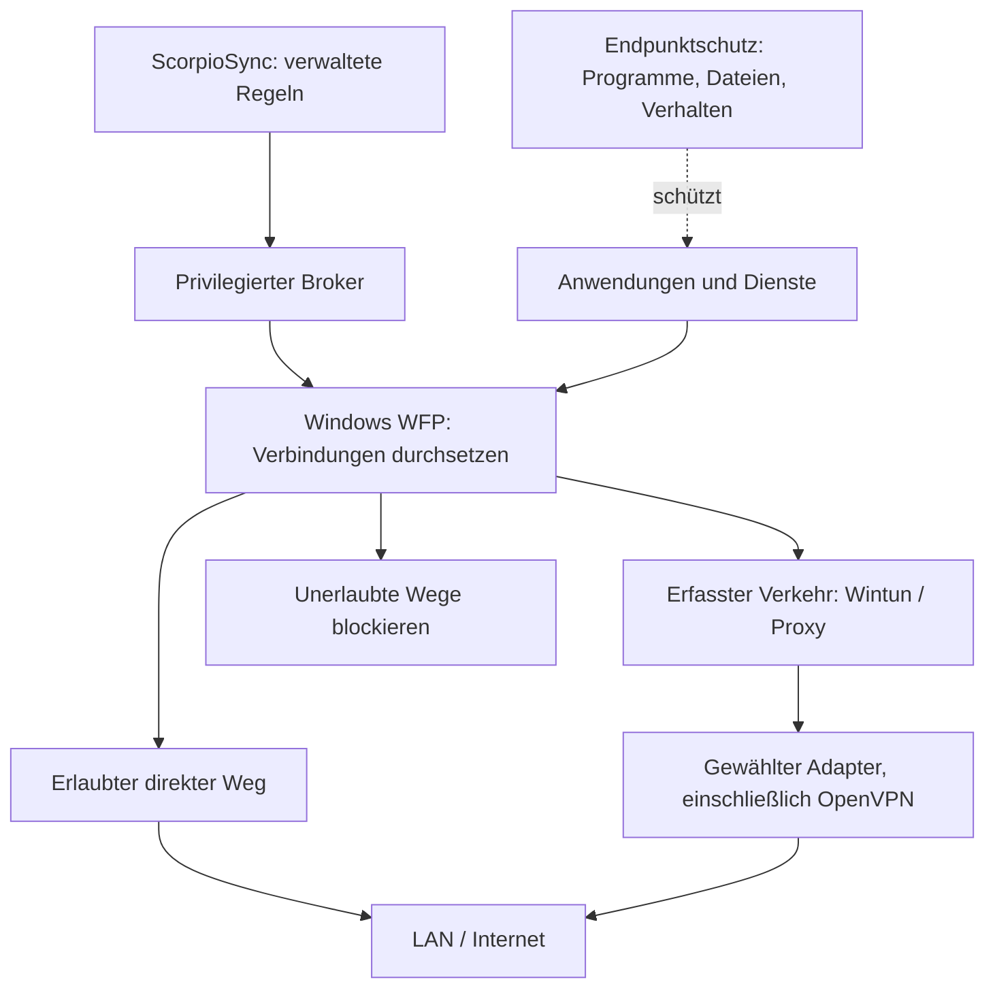

# Netzwerk-Membran: Machbarkeit und Grenzen

Stand: 22. September 2026. Recherche für Kaleidoscorp / ScorpioSync.

Ergänzung: Die [Prüfung von Thronion als Architekturquelle](THRONION_MEMBRANE_ASSESSMENT_2026-09-22.md)
bewertet konkrete Analysebausteine, reproduzierte Fehler und ihre mögliche Einordnung
als zusätzliches Risikosignal unterhalb der verbindlichen Regelentscheidung.

Dies ist eine technische Untersuchung und ein Architekturvorschlag, keine beschlossene
Architekturänderung oder Abnahme. Grundlage sind aktuelle Primärquellen und der lokale
Quellcode. Es wurden keine Firewallregeln, Netzwerkeinstellungen, Treiber oder Dienste
verändert und keine Malware ausgeführt. Eine isolierte Windows-Testumgebung fehlt weiterhin.

## Ergebnis

Eine verbindliche, anwendungsbezogene Netzwerkkontrolle ist technisch realisierbar und
passt zum Produkt. Sie könnte Firewallsteuerung, Regeln für ausgehende Verbindungen,
Netzwerkisolation und Teile des Web-/Malwareschutzes zusammenführen. Ihr größter Nutzen
wäre, unerlaubte Kommunikation auch dann zu unterbinden, wenn Schadcode bereits läuft.
Unter einer engen Freigabepolitik kann das auch unbekannte Schadprogramme einschränken,
ohne deren Signatur zu kennen. Das ist eine bedingte Schutzwirkung, keine gemessene
Erkennungsquote dieses Projekts.

**Reine Netzwerkkontrolle ersetzt keinen vollständigen Endpunktschutz.** Sie kontrolliert
weder alle Dateizugriffe noch die Ausführung und Integrität von Programmen. Lokale
Dateiverschlüsselung ist ein konkretes Gegenbeispiel: Der schädliche Vorgang benötigt
keinen Netzwerkzugriff. MITRE beschreibt ausdrücklich die Verschlüsselung lokaler und
entfernter Laufwerke. Die Schlussfolgerung für die Membran ist unsere technische
Ableitung daraus. [MITRE ATT&CK T1486](https://attack.mitre.org/techniques/T1486/)

Eine belastbare Produktpositionierung wäre: **kontrollierter Netzwerkzugang pro Anwendung
mit überprüfbaren Regeln und Schadensbegrenzung bei kompromittierten Anwendungen**.
„Antivirus-Ersatz“ wäre durch diese Architektur nicht gedeckt. Einzelne Netzwerkfunktionen
einer Sicherheits-Suite könnten später entfallen, wenn Funktionsumfang, Betrieb und
Wirksamkeit tatsächlich nachgewiesen sind. Daraus folgt keine Empfehlung, vorhandenen
Virenschutz zu deaktivieren.

## Was „Firewall assimilieren“ technisch bedeuten kann

| Auslegung | Machbarkeit und Konsequenz |
|---|---|
| Regeln und Bedienung zusammenführen | Realistisch: ScorpioSync verwaltet seine eigenen Netzwerkregeln über unterstützte Windows-Schnittstellen und erklärt deren Wirkung. Die Übernahme beliebiger Fremdprodukte braucht jeweils deren unterstützte Integration. |
| Zusätzliche verbindliche Kontrolle im Windows-Netzwerkstack | Realistisch: Windows Filtering Platform (WFP) bietet Filterpunkte, an denen Windows die Entscheidungen durchsetzt. Das ist eine Grundlage für die Membran. |
| Unterhalb jeder Firewall und unabhängig von einem kompromittierten Betriebssystem arbeiten | Für einen normalen Windows-Agenten kein haltbares Versprechen. WFP bleibt Teil des Betriebssystems und seiner Vertrauensbasis. |
| Netzwerk, Dateien, Prozesse und Speicher gemeinsam kontrollieren | Mögliches späteres Forschungsfeld, erweitert das Produkt aber zu Endpunktschutz/Sandboxing. Es ist dann keine reine Netzwerklösung mehr. |

WFP koordiniert mehrere Filteranbieter innerhalb des Windows-Netzwerkstacks. Eine eigene
Schicht wäre daher ein zusätzlicher Teilnehmer, kein automatisch übergeordneter Ersatz
aller anderen Schutzmechanismen. [Microsoft: WFP](https://learn.microsoft.com/en-us/windows/win32/fwp/about-windows-filtering-platform)
Die Konfliktauflösung kennt Schichten, Gewichte sowie übersteuerbare und nicht
übersteuerbare Entscheidungen. „Unsere Regel hat die höchste Priorität“ reicht als
Sicherheitsnachweis nicht aus. [Microsoft: Filter Arbitration](https://learn.microsoft.com/en-us/windows/win32/fwp/filter-arbitration)

Windows Firewall sollte dabei erhalten bleiben. Microsoft empfiehlt, sie nicht pauschal
abzuschalten; das Stoppen ihres Dienstes ist ausdrücklich nicht unterstützt.
[Microsoft: Windows Firewall](https://learn.microsoft.com/en-us/windows/security/operating-system-security/network-security/windows-firewall/)

## Welche Angriffe die Membran abdecken könnte

Die folgende Tabelle ist eine Bewertung der vorgeschlagenen Architektur, keine Aussage
über bereits vorhandenen Schutz. „Blockieren“ setzt voraus, dass der betreffende Pfad
tatsächlich erfasst wird und keine passende Freigabe existiert.

| Vorgang | Potenzielle Wirkung | Verbleibende Grenze |
|---|---|---|
| Neues Programm verbindet sich mit einem Angreiferserver | Verbindung durch ausgehende Standardverweigerung blockieren | Unterscheidet nicht automatisch legitime neue Software von Malware; Freigaben müssen gepflegt werden. |
| Schadcode lädt weitere Komponenten nach | Download über nicht erlaubte Ziele/Programme verhindern | Bereits vorhandene Schadfunktionen bleiben ausführbar. |
| Daten verlassen den Rechner zu einem nicht erlaubten Ziel | Transfer blockieren | Zulässige Ziele, Konten und Kommunikationsprogramme können missbraucht werden. |
| Angriff breitet sich über SMB/RDP oder andere Dienste aus | Nicht benötigte Verbindungen zwischen Rechnern begrenzen | Erlaubte administrative Verbindungen können weiterhin missbraucht werden. |
| Anwendung umgeht den vorgeschriebenen VPN-Weg | Direkten Ausweichpfad sperren | Tunnelbindung und sämtliche erfassten Protokolle müssen am Betriebssystem nachgewiesen werden. |
| Schadcode verschlüsselt lokale Dateien | Keine unmittelbare Wirkung | Datei- und Verhaltensschutz sowie Wiederherstellung bleiben erforderlich. |
| Schadcode läuft innerhalb eines erlaubten Browsers | Nur innerhalb der verbleibenden Netzwerkregeln eingrenzen | Der Prozessname beweist nicht, dass die ausgeführte Aktion vertrauenswürdig ist. |
| Rechner hat bereits einen kompromittierten Kernel | Keine verlässliche Garantie durch denselben Host-Agenten | Vertrauensbasis und Manipulationsschutz liegen außerhalb reiner Netzwerkkontrolle. |

Zwei Grenzen sind besonders relevant: Angreifer können legitime Webdienste für
Datenabfluss verwenden; eine erlaubte Cloud-Domain sagt nichts über den rechtmäßigen
Empfänger aus. [MITRE ATT&CK T1567](https://attack.mitre.org/techniques/T1567/)
Außerdem kann eingeschleuster Code im Kontext eines legitimen Prozesses dessen
System- und Netzwerkressourcen nutzen. [MITRE ATT&CK T1055](https://attack.mitre.org/techniques/T1055/)
Deshalb sind weder ein freigegebener Programmpfad noch ein gültiger Herausgeber allein
ein Beweis für eine ungefährliche Handlung.

Beispiel für eine sinnvolle Freigabe: Ein festgelegter Buchhaltungsclient darf ausschließlich
zum Unternehmensdienst und nur über den Unternehmens-VPN. Das begrenzt die möglichen
Netzwerkaktionen viel stärker als eine pauschale Freigabe des Programms ins Internet.
Die lokale Bearbeitung oder Beschädigung seiner Dateien wird dadurch nicht kontrolliert.

## Verschlüsselung und Sichtbarkeit

TLS schützt Kommunikationsinhalte gegen Mitlesen auf dem Übertragungsweg. Ein Filter
bekommt nicht allein durch seine Position im Netzwerkstack Zugriff auf HTTPS-Klartext.
[IETF: TLS 1.3, RFC 8446](https://www.rfc-editor.org/rfc/rfc8446.html)
Encrypted Client Hello schützt zusätzlich unter anderem den eigentlichen Servernamen im
TLS-Verbindungsaufbau. Der Standard ist seit März 2026 als RFC 9849 veröffentlicht.
[IETF: ECH, RFC 9849](https://www.rfc-editor.org/rfc/rfc9849.html)

Das verhindert nicht, eine Verbindung anhand von Anwendung, IP-Adresse, Port oder
Schnittstelle zu sperren. Es begrenzt aber die Aussage „wir wissen, welche Website oder
welchen Inhalt diese Verbindung verwendet“. Geteilte Serveradressen sind keine eindeutige
Domainidentität. DNS-Beobachtung allein beweist ebenfalls nicht die Identität des später
angesprochenen Dienstes.

Ein praktischer Vergleich: Microsoft dokumentiert bei Defender Network Protection
Einschränkungen für FQDN-Sperren in anderen Browsern bei QUIC, ECH und HTTP/2-Verbindungs-
zusammenlegung. Das sind Grenzen dieser konkreten Funktion, kein Beweis, dass QUIC
grundsätzlich ungefiltert bleiben müsste. [Microsoft: Network Protection](https://learn.microsoft.com/en-us/defender-endpoint/network-protection)

Empfehlung: Transportkontrolle, Zielidentität und Inhaltsprüfung getrennt ausweisen.
Unbekannte Zielidentität darf nicht still als geprüfte Domain gelten. Unternehmensprofile
können dafür verwaltete Resolver, Browser oder explizite Proxys vorsehen. TLS-Interzeption
wäre ein eigenes Vorhaben mit Schlüsselverwaltung und Anwendungskompatibilität; sie ist
keine Voraussetzung für einen ersten Netzwerkfilter und kein universeller AV-Ersatz.
Das Produkt sollte Verschlüsselung nicht pauschal schwächen, um mehr Sichtbarkeit zu behaupten.

## Abgleich mit dem vorhandenen Projekt

Die folgenden Aussagen wurden an lokalen Dokumenten und Code geprüft:

| Bereich | Befund am 22.09.2026 |
|---|---|
| Produktpfad | `PolicyEngine → RouteOrchestrator → AdmissionToken → DataPlane` ist vorhanden. Das Token schützt eine interne Programmierschnittstelle; es zwingt fremde Anwendungen nicht durch diesen Pfad. |
| Tatsächlicher Eingangsverkehr | `supervisor.rs` erzeugt bei Aktivierung einen eigenen `sskd-activate`-Flow. `ListRecentFlows` bleibt mangels implementiertem Traffic-Ingress leer. Es gibt noch keine systemweite Membran. |
| Anwendungsidentität | `FlowDescriptor.app_id` ist ein String. Die Routen-Vorschau übernimmt eine angegebene App-ID; das ist kein vom Kernel beglaubigter Prozessnachweis. |
| Capture-Entscheidung | Wintun bleibt der gewählte Ansatz für Verkehrserfassung. Die spätere Full-Coverage-Untersuchung erhebt die vollständige Verkehrserfassung zum v1-Ziel und behandelt WFP für App-Zuordnung gesondert. Die frühere Beschränkung auf Proxy/Fake-IP allein ist damit kein vollständiges Zielbild mehr. |
| Firewall | `firewall.rs` implementiert einen zwischenzeitlichen `netsh`-Aktuator. `WfpSessionFilter` ist ausdrücklich nicht implementiert. Vorhandene Regel-/Parserprüfungen sind keine Abnahme der realen Paketwirkung. |
| OpenVPN | Konfiguration, Broker und vorbereiteter Prozesslebenszyklus existieren. Die Aktivierung meldet weiter `OPENVPN_NOT_READY`; Prozess-HOLD ist kein nutzbarer oder vollständig abgesicherter Tunnel. |
| Mathematischer Entscheidungskern | ADR 0008 trennt ihn vom produktiven Verbindungspfad. Seine Modelle, Hashketten und Tests belegen für sich keine vollständige Erfassung oder Malware-Abwehr auf Windows. |

Lokale Belege: [Routingstatus](ROUTING_AND_OPENVPN_STATUS.md),
[Full-Coverage-Untersuchung](P4_FULL_COVERAGE_FEASIBILITY.md),
[Ingress-Entwurf](P4_INGRESS_DESIGN.md),
[ADR 0008](adr/0008-flow-path-owns-the-per-connection-decision.md),
[Supervisor](../crates/ssk-daemon/src/supervisor.rs),
[Flow-Modell](../crates/ssk-netadmin/src/flow.rs),
[Firewall-Aktuator](../crates/ssk-winhost/src/firewall.rs).
Ältere Aufwands-, Treiber- und Wettbewerbsangaben in den Entwurfsdokumenten wurden hier
nicht erneut verifiziert und werden nicht als aktuelle Fakten übernommen.

## Vorgeschlagene Architektur

**Wintun/OpenVPN und WFP erfüllen unterschiedliche Aufgaben.** Wintun und die Adapter
transportieren den erfassten Verkehr. WFP soll die zulässigen Verbindungen und Wege
verbindlich begrenzen. Das ergänzt die Capture-Entscheidung; es bedeutet nicht automatisch
einen Wechsel zu einem eigenen Capture-Treiber.

Das Diagramm zeigt Verantwortlichkeiten, keine schon implementierte Paketfolge. Auf
Windows können Umleitung und erneuter Verbindungsaufbau mehrere Filterpunkte durchlaufen.

Für einen ersten Versuch reichen voraussichtlich vorhandene WFP-Filteraktionen, die ein
privilegierter Dienst über die Management-API installiert. Microsoft stellt dafür
`FwpmFilterAdd0` bereit. [Microsoft: Filter-API](https://learn.microsoft.com/en-us/windows/win32/api/fwpmu/nf-fwpmu-fwpmfilteradd0)
ALE liefert anwendungs- und benutzerbezogene Verbindungsautorisierung; die dokumentierte
App-Identität basiert auf einem normalisierten Dateinamen, nicht auf einer Aussage über
die Unversehrtheit des laufenden Programms. [Microsoft: ALE](https://learn.microsoft.com/en-us/windows/win32/fwp/application-layer-enforcement--ale-)

Ein eigener Kernel-Callout ist ein gesonderter Ausbau für Anforderungen, die einfache
Filter nicht erfüllen, etwa zusätzliche Inspektion oder Paketveränderung.
[Microsoft: Callout Drivers](https://learn.microsoft.com/en-us/windows-hardware/drivers/network/introduction-to-windows-filtering-platform-callout-drivers)
Insbesondere das Anhalten einer neuen Verbindung bis zu einer individuellen Entscheidung
ist eine andere Anforderung als vorab installierte Regeln; WFP dokumentiert dafür
Kernel-Callouts. Bestehende Flows müssen bei Regeländerungen ebenfalls berücksichtigt
werden. [Microsoft: ALE Reauthorization](https://learn.microsoft.com/en-us/windows/win32/fwp/ale-re-authorization)
Ein treiberloser erster Filterprototyp wäre daher kein Beweis für die vollständige
spätere Per-Flow-Architektur.

Unsere vorgeschlagenen Anforderungen:

1. **Enge Freigaben:** Regeln binden Anwendung/Benutzer, Ziel, Protokoll und erlaubten
   Weg. Unternehmensprofile verweigern Verbindungen ohne passende Freigabe. Notwendige
   Basisdienste wie DNS, DHCP, Updates und Verwaltung brauchen ausdrücklich begrenzte Regeln.
2. **Nachweisbare Herkunft:** OS-Zuordnung, geschützte Programmpfade und Regeln zur
   Softwareidentität ergänzen einander. Nicht belegbare Zuordnung wird als unbekannt
   behandelt. Eine aus Paketen nachträglich geschätzte PID ist kein gleichwertiger Nachweis.
3. **Broker ohne pauschale Hintertür:** Ein Proxy erzeugt eigene ausgehende Sockets.
   Der ursprüngliche Absender und das erlaubte Ziel müssen über diesen Übergang erhalten
   bleiben. Eine allgemeine Internetfreigabe für den Broker darf nicht von beliebigen
   lokalen Clients als Umgehung benutzt werden.
4. **Geprüfte Tunnelbindung:** Ein ausgewähltes VPN erlaubt keinen direkten Rückfall.
   Auch Kontrollverbindungen des VPN-Prozesses und die Behandlung von DNS/IPv6 sind Teil
   der Regeln. Ein erfolgreicher OpenVPN-Status allein beweist die richtige Weiterleitung nicht.
5. **Erklärbare Verwaltung:** Zentral verteilbare, gegen Manipulation und veraltete
   Versionen geschützte Regeln, nachvollziehbare Sperrgründe, kontrollierte Ausnahmen und
   datensparsame Auditdaten. Beobachtete Kommunikation darf nicht automatisch als sicher
   freigegeben werden.

Diese Richtung passt zu identitäts- und ressourcenbezogenen Zero-Trust-Prinzipien.
Sie ergibt aber allein keine vollständige Zero-Trust-Architektur: NIST fordert, Vertrauen
nicht nur aus Netzwerkposition oder Gerätebesitz abzuleiten.
[NIST SP 800-207](https://csrc.nist.gov/pubs/sp/800/207/final)

## Kritischer Befund: Verhalten beim Absturz

Der vorhandene Firewall-Entwurf bevorzugt dynamische WFP-Sitzungen, damit ein abgestürzter
Broker keine dauerhafte Netzsperre hinterlässt. Windows entfernt die in einer solchen
Sitzung erzeugten Objekte beim Sitzungsende automatisch.
[Microsoft: FWPM_SESSION0](https://learn.microsoft.com/en-us/windows/win32/api/fwpmtypes/ns-fwpmtypes-fwpm_session0)

**Für eine dauerhaft geschlossene Membran reicht dieses Verhalten allein nicht.** Wenn
die Schutzsperren verschwinden und keine unabhängige Grundregel verbleibt, können zuvor
verbotene Wege wieder verfügbar sein. Das ist eine Ableitung aus der dokumentierten
Lebensdauer, kein hier beobachteter Angriff auf einen implementierten WFP-Aktuator.

Zu untersuchen wäre eine dauerhafte Grundpolitik mit eng begrenzten temporären Freigaben
und gesondertem Boot-Schutz. WFP unterscheidet dynamische, statische, persistente und
Boot-Filter; ihre Lebensdauer ist nicht austauschbar.
[Microsoft: Object Management](https://learn.microsoft.com/en-us/windows/win32/fwp/object-management)
Die konkrete Kombination von Schichten, Filtern und Ausnahmen muss die WFP-Konfliktregeln
einhalten. Ein pauschaler Blockfilter plus beliebige Freigaben in einer anderen Schicht
ist keine fertige Lösung.

Verfügbarkeit und Schutz müssen ausdrücklich getrennt entschieden werden: Ein strenges
Unternehmensprofil darf beim Defekt kontrolliert die Verbindung verlieren, benötigt aber
eine autorisierte lokale Wiederherstellung. Ein Modus, der beim Absturz Internetzugriff
wiederherstellt, darf danach keinen fortbestehenden Membranschutz anzeigen. Ein automatisch
auslaufender Totalblock löst diesen Zielkonflikt nicht.

## Nachweise vor einer Produktzusage

Zunächst ein begrenzter WFP-Versuch in einer wegwerfbaren Windows-VM, anschließend die
Integration mit Capture und VPN. Auf dem einzigen Entwicklungsrechner wären solche
Versuche aktuell keine geeignete Abnahme. Sichere Testprogramme und kontrollierte
Gegenstellen genügen für die ersten Versuche; echte Schadsoftware ist nicht erforderlich.

| Prüfung | Geforderter Nachweis |
|---|---|
| Direkte Umgehung | Nicht freigegebene Verbindungen erreichen die kontrollierte Gegenstelle nicht: IPv4, IPv6 einschließlich gemappter Adressen, TCP, UDP/QUIC, harte Ziel-IP, abweichender Resolver. |
| Namensregeln | DoH/DoT, ECH, gemeinsame Server-IP und Verbindungswiederverwendung führen nicht zu fälschlich bestätigter Zielidentität. Fehlende Sichtbarkeit wird erkennbar behandelt. |
| Übergänge | Dienstabsturz, Neustart, Systemstart, Standby, Netzwechsel und VPN-Verlust öffnen keinen verbotenen Pfad im strengen Profil. |
| Bestehende Verbindungen | Regelentzug betrifft auch bereits laufende TCP-/UDP-Flows; gemessen wird der Zeitpunkt der letzten noch übertragenen Nutzdaten. |
| Attribution und Vermittlung | Zwei Programme mit verschiedenen Rechten, Prozessneustart/PID-Wiederverwendung und ein lokaler Proxy erhalten keine fremden Freigaben. |
| Koexistenz | Windows Firewall und eingesetzter Endpunktschutz bleiben wirksam; Konflikte und Blockgründe werden korrekt gemeldet. |
| Weitere Netzwerkbereiche | Loopback, LAN, virtuelle Adapter, WSL/VM-Verkehr, eingehende Verbindungen, Multicast und benötigte Kontrollprotokolle werden ausdrücklich geprüft oder als nicht abgedeckt ausgewiesen. |
| Betrieb | Regelwechsel sind atomar, unbekannte Zustände sichtbar; Installation, Update, Rücknahme und lokale Wiederherstellung hinterlassen keine unkontrollierten Freigaben oder Sperren. |
| Aufwand und Nutzen | Verbindungsaufbauzeit, Durchsatz, CPU/RAM, Fehlblockierungen und tatsächliche Szenarioabdeckung unter repräsentativer Last messen. Keine Wirksamkeitsprozente aus Anzahl bestandener Unit-Tests ableiten. |

Die Evidenz muss erlaubte und verbotene Versuche am Endpunkt und an einer getrennten
kontrollierten Gegenstelle vergleichen. Ein vorhandener Filter, ein API-Erfolg oder ein
Audit-Eintrag allein belegt nicht die Netzwerkentscheidung. Lokale Dateiveränderung ohne
Netzwerk wird als bewusstes Gegenbeispiel dokumentiert, damit der begrenzte Schutzumfang
nicht später als vollständiger Malware-Schutz ausgegeben wird.

## Empfohlene Produktentscheidung

Die Membran als zusätzliches Sicherheitsziel verfolgen: zuerst verbindliche
Anwendungs-/Zielkontrolle und VPN-Wegbindung, danach begründet ausgewählte Analysefunktionen.
Die bestehende Windows-Sicherheitsplattform integrieren und Endpunktschutz beibehalten.
Für lokale Risiken stehen unter anderem Anwendungssteuerung und Regeln zur Reduzierung
der Angriffsfläche zur Verfügung; deren Verfügbarkeit und Verwaltung sind separat für die
unterstützten Windows-Editionen zu prüfen.
[Microsoft: Application Control](https://learn.microsoft.com/en-us/windows/security/application-security/application-control/app-control-for-business/appcontrol),
[Microsoft: ASR-Regeln](https://learn.microsoft.com/en-us/defender-endpoint/attack-surface-reduction-rules-reference)

Der nächste konkrete Entwicklungsschritt wäre ein Entwurf für Schutzumfang, Identität,
Filterlebensdauer und Wiederherstellung sowie ein isolierter WFP-Prototyp mit obiger
Abnahme. Diese Recherche ändert weder die aktuelle Roadmap verbindlich noch behauptet sie
bereits vorhandenen Schutz. Sie begründet, warum WFP-Durchsetzung und die bisherige
Capture-/OpenVPN-Arbeit gemeinsam geplant werden sollten.
