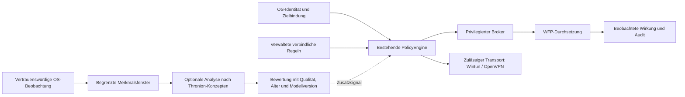

# Thronion als Quelle für die Netzwerk-Membran

Stand: 22. September 2026. Untersucht wurde
[LashSesh/thronion, Commit 6369565780b47cb620c5adcde6384ba996250b0e](https://github.com/LashSesh/thronion/tree/6369565780b47cb620c5adcde6384ba996250b0e).
Der Commit datiert vom 21.09.2026. Gegenstand ist die Eignung für ScorpioSync, keine
vollständige Sicherheitsprüfung von Thronion und keine Änderung seines Quellcodes.

Die erste daraus abgeleitete, getrennte [Analysekomponente mit Offline-Replay](NETWORK_ANALYSIS_BASELINE.md)
ist inzwischen implementiert. Sie verwendet einfache, nachvollziehbare Grenzwerte und
übernimmt keinen Thronion-Code in den produktiven Entscheidungsweg.

## Entscheidung

**Geeignet als Quelle für einzelne Analysekonzepte und Experimente. Nicht geeignet als
unverändert übernehmbare Sicherheitsarchitektur oder als Ersatz für die WFP-Durchsetzung.**

Der übertragbare Kern ist eine Folge aus Beobachtung, Merkmalen, Mustervergleich und
Bewertung. Daraus lässt sich eine zusätzliche Analysekomponente für die Membran ableiten.
Die verbindliche Berechtigung zu einer Verbindung muss weiterhin aus nachvollziehbaren
Regeln und vertrauenswürdiger OS-Zuordnung entstehen.

Das Repository enthält reale mathematische und analytische Implementierungen. Seine
Selbsteinstufung als produktionsreifer DDoS-Schutz geht jedoch über den nachweisbaren
Produktpfad hinaus. Eine Bibliothek, die ein Muster bewertet, beweist weder vollständige
Verkehrserfassung noch tatsächliche Sperrung. Außerdem enthält der geprüfte Stand
Fehler, die eine direkte Verwendung als Sicherheitsentscheidung ausschließen.

## Was sich sinnvoll ableiten lässt

| Thronion-Konzept | Nutzen für ScorpioSync | Erforderliche Anpassung |
|---|---|---|
| Beobachtung → Merkmale → Klassifikation | Austauschbare Analyseschritte mit klaren Datenverträgen | Eingaben stammen aus belegbaren Windows-Flows statt aus Tor-Circuit-Feldern. |
| Zeitverhalten und Mengenmerkmale | Kandidaten für die Erkennung von Verbindungsfluten, ungewöhnlichen Transfers oder periodischen Kontakten | Pro Anwendung/Ziel/Richtung und über begrenzte Zeitfenster auswerten; Nutzen gegen einfache Vergleichsverfahren messen. |
| Regionen und Ähnlichkeitswerte | Modell für typische und abweichende Kommunikationsmuster | Eingaben validieren, Scores kalibrieren, unbekannte Muster ausdrücklich ausweisen. |
| Spektrale Analyse | Experiment für Periodizität in beobachteten Ereignisreihen | Definierte Zeitreihen verwenden. Eine FFT über Paketbytes ist nicht automatisch eine Analyse des zeitlichen Netzwerkverhaltens. |
| Drei Zustände | Anregung, Unsicherheit nicht in eine Ja/Nein-Antwort zu pressen | Eigener Ergebnistyp für Evidenzqualität und Risikobewertung; die DTL-Klassen sind keine fertigen Netzwerkberechtigungen. |
| Metriken und begrenzte Modellgröße | Betriebsbeobachtung und Ressourcenplanung | Tatsächliche Durchsetzung, Analyseausfälle und Ereignisverluste messen; harte Grenzen für Zeit, Speicher und Warteschlangen definieren. |
| Laufendes Lernen | Spätere Anpassung an veränderte Nutzung | Gesonderter Lernprozess mit vertrauenswürdigen Labels, überprüften Modellversionen und Rücknahme; keine automatische Freigabe aus beobachtetem Verkehr. |

Anknüpfungspunkte im Original:
[Architekturentwurf](https://github.com/LashSesh/thronion/blob/6369565780b47cb620c5adcde6384ba996250b0e/THRONION_ARCHITECTURE.md),
[Merkmale und Regionen](https://github.com/LashSesh/thronion/blob/6369565780b47cb620c5adcde6384ba996250b0e/thronion/src/thronion/mod.rs),
[Spektralanalyse](https://github.com/LashSesh/thronion/blob/6369565780b47cb620c5adcde6384ba996250b0e/thronion/src/resonance/spectrum.rs),
[Metriken](https://github.com/LashSesh/thronion/blob/6369565780b47cb620c5adcde6384ba996250b0e/thronion/src/service/mod.rs).
Die rechte Tabellenspalte sind unsere Ableitungen, keine bereits vorhandenen Funktionen.

## Befunde, die eine direkte Übernahme verhindern

### 1. Der Schutzpfad ist nicht fertig verdrahtet

`ThronionService::start()` setzt ausschließlich einen Laufstatus auf `true`; die Methode
startet weder Tor-Erfassung noch Klassifikation oder Durchsetzung. Es existiert im
geprüften Cargo-Paket kein ausführbarer Einstiegspunkt. `get_circuit_metadata()` liest
eine Antwort, gibt aber leere Zell-/Zeitdaten und null Bytes zurück. Die Ereignisschleife
ist separat definiert, wird vom Dienst jedoch nicht gestartet.
[Service, ab Zeile 360](https://github.com/LashSesh/thronion/blob/6369565780b47cb620c5adcde6384ba996250b0e/thronion/src/service/mod.rs#L360),
[Tor-Anbindung, ab Zeile 127](https://github.com/LashSesh/thronion/blob/6369565780b47cb620c5adcde6384ba996250b0e/thronion/src/tor/mod.rs#L127)

Der „Absorber“ liefert ein Boolean-Ergebnis und zählt klassifizierte Pakete. Er verwirft
an dieser Stelle keine OS-Pakete. Ein Zähler namens `packets_absorbed` belegt deshalb
keine tatsächliche Netzsperre.
[Absorber, ab Zeile 97](https://github.com/LashSesh/thronion/blob/6369565780b47cb620c5adcde6384ba996250b0e/thronion/src/resonance/absorber.rs#L97)

### 2. Sicherheitsrelevante Fehler in der Klassifikation

- Neue Regionen erhalten das Angriffsetikett als dritten Konstruktorparameter. Dieser
  Parameter ist die Lernrate; die Angriffswahrscheinlichkeit beginnt immer bei 0,5.
  Ein zuerst gutartig gelerntes Muster erhält so Lernrate null.
- Leeres Modell und schwache Übereinstimmung ergeben `is_attack = false`. Unsicherheit
  ist dadurch nicht von einer positiven Unbedenklichkeitsbewertung getrennt.
- `attack_threshold` wird gespeichert und angezeigt, aber nicht für die Entscheidung
  verwendet. Die tatsächlichen Schwellen sind fest codiert.
- Die Merkmalsumrechnung berechnet bei null Bytes den Logarithmus von null. Nicht endliche
  Werte können anschließend durch die Vergleiche zur Einstufung als harmlos gelangen.

[Konstruktor, ab Zeile 88](https://github.com/LashSesh/thronion/blob/6369565780b47cb620c5adcde6384ba996250b0e/thronion/src/thronion/mod.rs#L88),
[Entscheidung und Lernen, ab Zeile 342](https://github.com/LashSesh/thronion/blob/6369565780b47cb620c5adcde6384ba996250b0e/thronion/src/thronion/mod.rs#L342),
[Merkmalsumrechnung, ab Zeile 59](https://github.com/LashSesh/thronion/blob/6369565780b47cb620c5adcde6384ba996250b0e/thronion/src/thronion/mod.rs#L59)

### 3. Mathematische Größen sind noch keine Sicherheitsnachweise

`DeltaKernel::coherence()` summiert die Wahrscheinlichkeiten eines normierten Zustands
und dividiert durch 13. Daraus folgt für solche Zustände stets 1/13. Diese Größe kann
daher allein nicht zwischen sicheren und gefährlichen Netzwerkzuständen unterscheiden.
[Delta-Kernel, ab Zeile 92](https://github.com/LashSesh/thronion/blob/6369565780b47cb620c5adcde6384ba996250b0e/thronion/src/delta/kernel.rs#L92)

Die Bezeichnung „quantum-inspired“ beschreibt hier klassisch berechnete Modelle. Eine
deterministische Erweiterung von fünf Merkmalen auf 13 Koordinaten liefert keine neuen
Beobachtungen. Sie kann eine nützliche Darstellung sein, muss ihren zusätzlichen Nutzen
aber im Vergleichstest zeigen. Auch `log2(3)` beschreibt die maximale Information eines
dreistufigen Symbols, keine um 58,5 Prozent bessere Angriffserkennung.
[DTL](https://github.com/LashSesh/thronion/blob/6369565780b47cb620c5adcde6384ba996250b0e/thronion/src/core/dtl.rs#L101)

Beim Absorber erhöht das Senken der Schwelle den Resonanzwert. Da niedrige Resonanz zur
Sperrentscheidung führt, kann wiederholte vermeintliche Absorption dieselbe Eingabe
später passieren lassen. Die gewünschte Regelungsrichtung muss ausdrücklich spezifiziert
und gegen Umgehung durch kontrollierte Eingaben getestet werden.
[Absorber-Rückkopplung](https://github.com/LashSesh/thronion/blob/6369565780b47cb620c5adcde6384ba996250b0e/thronion/src/resonance/absorber.rs#L123)

### 4. Die Qualitätsaussagen sind nicht durch die vorhandenen Tests gedeckt

Die Integrationsfälle arbeiten mit selbst konstruierten Daten. Der als Angriff
bezeichnete Ablauf prüft nach dem Lernen Ähnlichkeit und Regionszuordnung, aber nicht,
dass `is_attack` tatsächlich wahr ist. Der Klassifikationswert wird dort ausdrücklich
in `_is_attack_learned` abgelegt.
[Integrationstest, ab Zeile 80](https://github.com/LashSesh/thronion/blob/6369565780b47cb620c5adcde6384ba996250b0e/thronion/tests/integration_tests.rs#L80)

Für die behaupteten Erkennungs-/Fehlalarmquoten habe ich im untersuchten Stand keinen
reproduzierbaren, getrennten Testdatensatz samt Auswertung gefunden. Die mitgelieferte
Benchmarkdatei importiert außerdem `qrik`, während das Paket `thronion` heißt und keine
solche Abhängigkeit deklariert.
[Benchmark](https://github.com/LashSesh/thronion/blob/6369565780b47cb620c5adcde6384ba996250b0e/thronion/benches/resonance_bench.rs#L4),
[Paketmanifest](https://github.com/LashSesh/thronion/blob/6369565780b47cb620c5adcde6384ba996250b0e/thronion/Cargo.toml)

## Abgeleitete Zielarchitektur für ScorpioSync

Das ist ein Vorschlag für Verantwortlichkeiten, keine bereits implementierte Paketfolge.
Er erhält die Zuständigkeit aus [ADR 0008](adr/0008-flow-path-owns-the-per-connection-decision.md):
Die bestehende PolicyEngine bleibt der Entscheidungspunkt. Weder der mathematische
ScorpioSync-Kern noch ein importierter Thronion-Kern wird dadurch zu einem zweiten
privilegierten Entscheider.

Die entscheidenden Verträge wären:

1. **Analyse besitzt keine Freigaberechte.** Ein niedriger Risikowert hebt niemals eine
   verbindliche Sperre, eine fehlende Identität oder eine vorgeschriebene VPN-Bindung auf.
   Zusätzliche Einschränkungen sind nur im Rahmen der verwalteten Regeln zulässig.
2. **Unsicherheit hat einen eigenen Zustand.** Fehlende Daten, ungültige Zahlen, veraltete
   Ergebnisse, Ereignisverlust oder ein nicht geladenes Modell ergeben `Unavailable`.
   Nur gültige Ergebnisse dürfen `NoAnomalyObserved` oder `Suspicious` melden.
   `NoAnomalyObserved` bedeutet ausdrücklich nicht „schadfrei“.
3. **Das Profil bestimmt die Folgen fehlender Analyse.** Wo Analyse verbindlich gefordert
   wird, wird ohne gültigen Nachweis verweigert. Bei optionaler Beobachtung bleiben die
   normalen Netzwerkregeln wirksam; die Anzeige meldet die reduzierte Beobachtung.
4. **Schnelle Durchsetzung und aufwendige Analyse sind getrennt.** Vorbereitete Regeln
   begrenzen Verbindungen; Zeitreihenanalyse läuft mit festem Budget nebenher. Eine
   langsame FFT oder Modelloptimierung darf den privilegierten Dienst nicht unbeschränkt
   blockieren. Eine spätere Einschränkung muss auch bestehende Verbindungen erreichen.
5. **Modelle sind versionierte Artefakte.** Ein Ergebnis bindet Modell- und Merkmalsversion,
   Beobachtungsfenster, Herkunft, Qualität und Gültigkeitsdauer. Eine Ähnlichkeit wird nicht
   ohne Kalibrierung als Angriffswahrscheinlichkeit ausgegeben.
6. **Lernen erteilt keine eigenen Berechtigungen.** Zunächst Offline-Training aus geprüften
   Labels, danach Vergleich im Beobachtungsmodus und kontrollierte Modellfreigabe. Keine
   unbemerkte Anpassung der Schutzregeln an möglicherweise feindlichen Verkehr.

Insbesondere Tor-Zelltypen lassen sich nicht als allgemeine Windows-Merkmale übernehmen.
Geeignete erste Kandidaten sind Verbindungsraten, fehlgeschlagene Verbindungen,
Zielwechsel, Byteverhältnisse und zeitliche Muster. Ihr Nutzen ist eine Hypothese.
DNS-/TLS-Sichtbarkeit und Vertrauenswürdigkeit der App-Zuordnung bleiben die im
[Membranbericht](NETWORK_MEMBRANE_RESEARCH_2026-09-22.md) beschriebenen eigenen Probleme.

## Empfohlene Extraktion

Zuerst die Schnittstellen und das Drei-Zustands-Verhalten spezifizieren. Danach eine
kleine, unprivilegierte Analysekomponente mit gespeicherten, synthetischen Flow-Ereignissen
aufbauen. Im ersten Vergleich genügen einfache Raten-/Mengenregeln und ein nachvollziehbares
statistisches Modell. Die Thronion-Varianten treten gegen diese Baseline an, bei gleichen
Eingaben, Zeitbudgets und getrennten Trainings-/Testdaten.

Nur wenn sie bei Fehlalarmen, Erkennung und Laufzeit einen messbaren Vorteil liefern,
werden ausgewählte Verfahren übernommen. Die erste Produktintegration sollte im
Beobachtungsmodus laufen. Eine direkte Cargo-Abhängigkeit auf das gesamte Thronion-Paket
oder die Übernahme seiner sieben Ebenen ist dafür nicht erforderlich.

Die WFP-Arbeit bleibt notwendig: Thronion liefert keine Windows-Durchsetzung,
VPN-Wegbindung, Boot-Sicherung oder manipulationsgeschützte Wiederherstellung. Umgekehrt
könnte eine überprüfte Analysekomponente später Hinweise auf ungewöhnliche Kommunikation
liefern, die eine reine Freigabeliste nicht erklärt.

## Prüfumfang und Reproduzierbarkeit

Untersucht wurden Bibliothekseinstieg, Manifest, Dienst, Tor-Anbindung, Klassifikation,
Lernen, Spektralanalyse, Absorber, Delta-Kernel, DTL und die Integrations-/Benchmarkfälle,
ergänzt durch die zugehörigen Architekturabschnitte. Das Repository enthält 25 Rust-Dateien
unter `src` mit 6.474 Zeilen einschließlich Kommentaren und eingebetteten Tests. Diese
Zählung ist keine Aussage über vollständige Auditabdeckung.

Die unveränderte Git-Kopie liegt unter `target/restart-audit/thronion-source-2026-09-22/`.
Für Ausführung wurde das Rust-Paket in eine getrennte Testkopie außerhalb des
ScorpioSync-Cargo-Workspaces kopiert. Es wurde weder als Produktabhängigkeit eingebunden
noch ein Tor-Dienst, VPN oder Netzwerkfilter gestartet. Da upstream kein Cargo.lock
vorliegt, verwendet der Test einen am Prüftag aufgelösten und anschließend gesperrten
Abhängigkeitssatz; historische Testergebnisse sind damit nicht exakt reproduziert.

Die zusätzlichen [Diagnoseproben](../scripts/research/thronion-review-probes.rs) prüfen
gezielt die beobachteten Gegenbeispiele. Sie behaupten das fehlerhafte Verhalten und
sollen deshalb auf diesem Commit bestehen; für einen reparierten Stand müssen sie in
Tests des gewünschten Verhaltens umgeschrieben werden.

Ausgeführt unter Windows mit Rust/Cargo 1.95.0:

| Prüfung | Ergebnis |
|---|---|
| Originale Tests, `cargo test --offline --locked -j 2` | 149 Unit-Tests, 6 Integrationstests und 1 Doc-Test bestanden; 1 vorhandener langsamer Optimierungstest ignoriert. |
| Zusätzliche Diagnoseproben, `cargo test --offline --locked --test review_probes -j 2` | Alle 6 Gegenbeispiele reproduziert. Dies bestätigt Defekte, keine verbesserte Schutzwirkung. |
| Alle Targets, `cargo check --offline --locked --all-targets -j 2` | Fehlgeschlagen: Benchmark importiert die nicht vorhandene Crate `qrik`, mit weiteren daraus folgenden unbekannten Typen. |

Die Gegenbeispiele zeigen konkret:

1. Ein einmal als Angriff gelerntes Muster wird bei nahezu perfekter Übereinstimmung
   weiterhin als harmlos ausgegeben.
2. Ein zuerst als harmlos gelerntes Muster bleibt nach 20 identischen Angriffslabels harmlos.
3. Null Bytes erzeugen nicht endliche Merkmale; die Bewertung fällt auf harmlos zurück.
4. Die konfigurierten Angriffsschwellen 0 und 1 ergeben dieselbe Entscheidung.
5. Zwei verschiedene normierte Zustände haben dieselbe Kohärenz 1/13.
6. Die Absorber-Rückkopplung kann bei unveränderter Eingabe von Sperren auf Durchlassen wechseln.

Logs liegen unter `target/restart-audit/thronion-tests.log`, `thronion-probes.log` und
`thronion-all-targets.log`. Die separate Testkopie befindet sich, relativ zum übergeordneten
Projektordner, in `.research/thronion-2026-09-22/`. Ihr generiertes `Cargo.lock` hat SHA-256
`a769d01c2c7ec4926d9a5a1fed41cbe38fae7c146637fc86c9cb43bb0d8e9dcc`.
Zum Wiederholen die Diagnoseprobe als `tests/review_probes.rs` in diese Kopie übernehmen
und die obigen Befehle dort ausführen. Die ursprüngliche Git-Kopie blieb unverändert.

Es wurde keine belastbare Erkennungsquote, reale Tor-Abwehr, WFP-Paketwirkung oder
Windows-Produktreife nachgewiesen. Keine Codeänderung an ScorpioSync übernimmt Thronion
als Abhängigkeit oder aktiviert eine Schutzfunktion.
